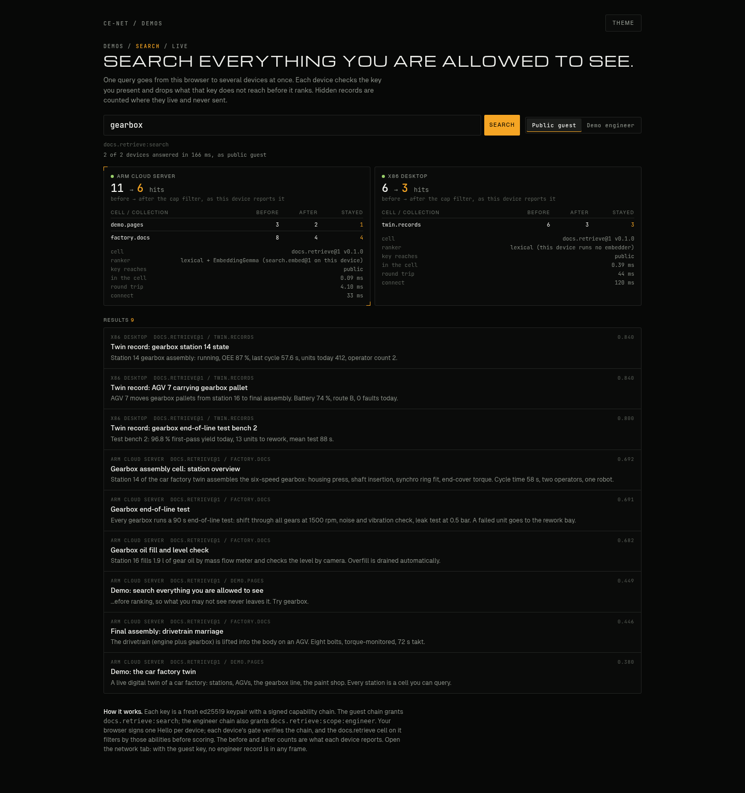

# Mesh search: search everything you are allowed to see

One query goes from your browser to several devices at once. Each device checks the key you present and drops every
record that key does not reach **before it ranks**. Hidden records get counted where they are stored and are never
sent. Switch keys and the result set changes. The hidden hits never left their device.



## What you see

- You search `gearbox`. Results come back from two devices (an ARM cloud server and an x86 desktop). Each result is
  labelled with its device class and the cell and collection it came from (`docs.retrieve@1 / factory.docs`,
  `twin.records`, `demo.pages`).
- Each device reports two counts per collection: hits **before** the cap filter and hits **after** it. It also reports
  how long the cell took, the round trip, the connect time and which ranker it used. The ARM server blends lexical
  scores with EmbeddingGemma vectors from its local `search.embed@1`. The desktop has no embedder, so it ranks
  lexically and says so.
- Switch between **Public guest** and **Demo engineer**. The engineer key also reaches records published with scope
  `engineer`: torque specs, supplier deviations, warranty returns and shift handovers.

Measured live on 2026-11-15 ([proof/report.json](proof/report.json), [proof/cli.txt](proof/cli.txt)):

| key | device | before -> after | in the cell | round trip from the browser |
|---|---|---|---|---|
| guest | ARM cloud server | demo.pages 3 -> 2, factory.docs 8 -> 4 | 0.09 ms | 4 ms |
| guest | x86 desktop | twin.records 6 -> 3 | 0.39 ms | 44 ms |
| engineer | ARM cloud server | demo.pages 3 -> 3, factory.docs 8 -> 8 | 0.13 ms | 2 ms |
| engineer | x86 desktop | twin.records 6 -> 6 | 0.12 ms | 39 ms |

The browser received 4 WebSocket frames (2,099 bytes) under the guest key. None of them contains any engineer-only
record id or the `(engineer)` title tag. Under the engineer key all 8 engineer-only ids appear
(`scripts/prove.mjs` records every frame through the DevTools protocol, the same data the network tab shows).

## How it works

```
browser (key = ed25519 seed + ce-cap chain, kept in the # part of the link, never sent to a server)
  |  one WebSocket per device: wire.ws-door /wire and /wire?at=<peer node id>
  v
ce-wire door on each device -> ce-cap gate (verifies the chain: signed links, not expired, rooted at a mesh key)
  -> docs.retrieve@1:   match all -> count per collection -> DROP scopes the grant does not reach -> rank -> send
```

| Cell | Role here |
|---|---|
| `docs.retrieve@1` (this repo, `crates/docs-retrieve`) | Holds a device's records. The `Search` op filters by the caller's abilities first, then ranks |
| `ce-cap` / ce-gate | Each device verifies the presented chain on its own. The cell sees only the abilities the gate passed in |
| `wire.ws-door` | The browser speaks ce-wire over a WebSocket. `Mint` issues the two demo keys |
| `search.embed@1` | EmbeddingGemma vectors on devices that run it; optional |
| `crates/ws-pipe` | wire.ws-door's `/wire` pipe from its library, used only where the installed ws-door predates `?at=<peer>` |

Abilities: guest = `docs.retrieve:search`; engineer = `docs.retrieve:search` + `docs.retrieve:scope:engineer`.
A record of scope `public` needs only the first. Any other scope needs `docs.retrieve:scope:<scope>` (or a wildcard
that covers it). The fan-out runs from the viewer's own key, so each device can filter for that viewer. A server-side
fan-out that called the devices with its own key could not do that.

## Run it in under 5 minutes (on a ce-net node)

It needs a ce-net node (ce-wire door on 7700, a node key) and read access to the ce-net Rust crates (rust-stack,
wire-ws-door, search-embed). Those crates are not public yet.

```sh
git clone https://github.com/ce-net/demo-mesh-search && cd demo-mesh-search
cargo build --release                                   # docs-retrieve + ws-pipe, about 2 min warm
./target/release/docs-retrieve seed corpus/ops          # or corpus/desk on a second device
./target/release/docs-retrieve serve &                  # or: cp deploy/*.service ~/.config/systemd/user/
./target/release/ws-pipe 127.0.0.1:7794 &               # skip if your wire.ws-door serves /wire?at=
G=$(wire-ws-door mint http://127.0.0.1:8851/ docs.retrieve:search --ttl 3600 | sed 's/.*#g=//')
E=$(wire-ws-door mint http://127.0.0.1:8851/ docs.retrieve:search docs.retrieve:scope:engineer --ttl 3600 | sed 's/.*#g=//')
./target/release/docs-retrieve query --grant "$G" gearbox     # the terminal view of one device
./scripts/build-web.sh && (cd web && python3 -m http.server 8851 --bind 127.0.0.1 &)
echo "http://127.0.0.1:8851/#w=ws://127.0.0.1:7794/wire&guest=$G&engineer=$E"
```

`web/sources.json` lists the devices to ask: `""` is this node, and any other entry is a peer's node id prefix (16 hex
characters) from the node's peers file. Proof: `node scripts/prove.mjs "<that url>" proof/` (needs `puppeteer-core`
and Chromium).

## Repo

- `crates/docs-retrieve-api`: the typed API (`ce_wire::api!`); `web/gen/DocsRetrieve.ts` is generated from it by
  `ce-wire-gen --lang ts-web`.
- `crates/docs-retrieve`: the cell plus the `seed` and `query` commands. Unit tests check that a hidden record's
  content is never in the answer.
- `corpus/`: the demo corpora (factory docs, twin records, demo pages); each line has a `scope`.
- `web/`: the page (no framework; ce-net design tokens).

Apache-2.0. Author: Leif Rydenfalk.

## Status of the public page (ce-net.com/demos/search)

The page is staged in the ce-net.com site repo under `demos/search/`. It goes live on the next Pages deploy
(`sh bin/deploy-cloudflare.sh`, run from that repo where the Cloudflare login exists). It works only after these three steps:

1. **A public wss route** `wss://apps.ce-net.com/demo-search/wire` to a `/wire` pipe that allows `?at=<peer>` for
   `docs.retrieve` only. wire.ws-door's public listener refuses `at=` today, and the session listener must not face
   strangers. The fix belongs in wire.ws-door: let `?at=` pass on the public listener for apis listed in
   `WIRE_WS_PUBLIC_APIS`.
2. **Keys for strangers.** A grant lasts at most 24 h, so the page needs a small mint route (wire.ws-door `Mint`
   behind a rate limit) instead of keys pasted into the link.
3. TLS on ce-wire for any hop that crosses the public internet. In this run both devices are on one private network.
